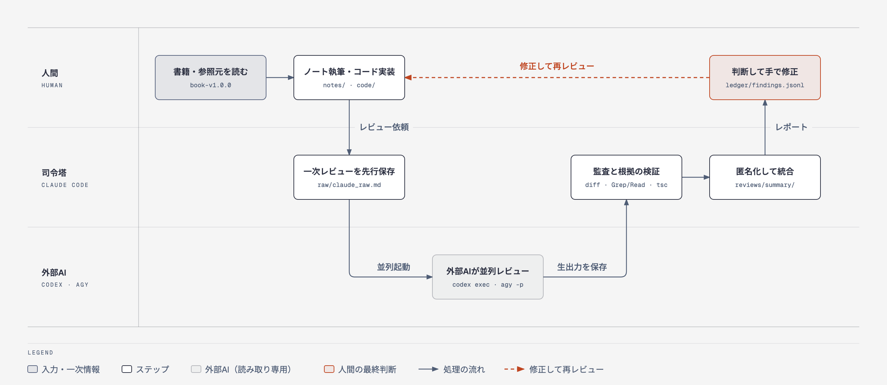

# ts-backend

『[実践TypeScriptバックエンド開発：データと関数によるドメインモデリングで堅牢性を高める](https://gihyo.jp/book/2026/978-4-297-15725-8)』（木村 彰宏 著、技術評論社）の学習用リポジトリです。

書籍のサンプルコード（[kimutyam/backend-ts-hands-on](https://github.com/kimutyam/backend-ts-hands-on)）を最終的な到達点として、**自分の手で少しずつ再構築**していきます。学習ノートと実装コードは、複数のAI（Claude Code / Codex CLI / Antigravity CLI）にレビューさせ、その指摘を一次情報で検証したうえで、人間が判断して修正します。

## このリポジトリで行うこと

1. **書く（人間）**: 書籍と参照元を読み、ノート（`notes/`）とコード（`code/`）を自分で書く。
2. **レビューする（司令塔: Claude Code）**: `/multi-note-review notes/chXX.md` で、まず Claude 自身の一次レビューを保存し、その後 Codex と agy を読み取り専用で並列に実行する。
3. **検証して統合する（司令塔: Claude Code）**: `notes/` と `code/` が変更されていないことを監査し、指摘の根拠を検証して、レビュアー名を伏せたレポートにまとめる。
4. **判断して直す（人間）**: レポートと一次情報（書籍・参照元の `book-v1.0.0` など）を見て、人間が正誤を判断し、手で修正する。AIは `notes/` と `code/` を書き換えない。

## ドキュメント

| ファイル | 内容 |
| --- | --- |
| [AGENTS.md](AGENTS.md) | 全AI共通の規約（ディレクトリと権限、設計規約、レビュー観点、一次情報の優先順位、ネタバレ方針、コミット規約） |
| [CLAUDE.md](CLAUDE.md) | Claude Code が司令塔として外部CLIを呼び出し、統合レビューを行う手順 |
| [.claude/skills/multi-note-review/SKILL.md](.claude/skills/multi-note-review/SKILL.md) | `/multi-note-review` スキル（このリポジトリ専用） |
| [docs/diagram/repo-overview.html](docs/diagram/repo-overview.html) | 上の図のソース（[diagram-design](https://github.com/cathrynlavery/diagram-design) で作成） |
