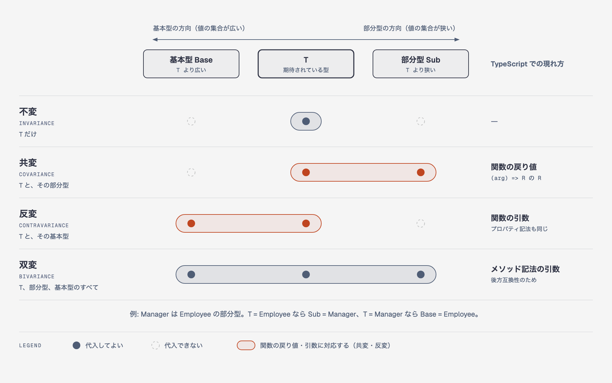
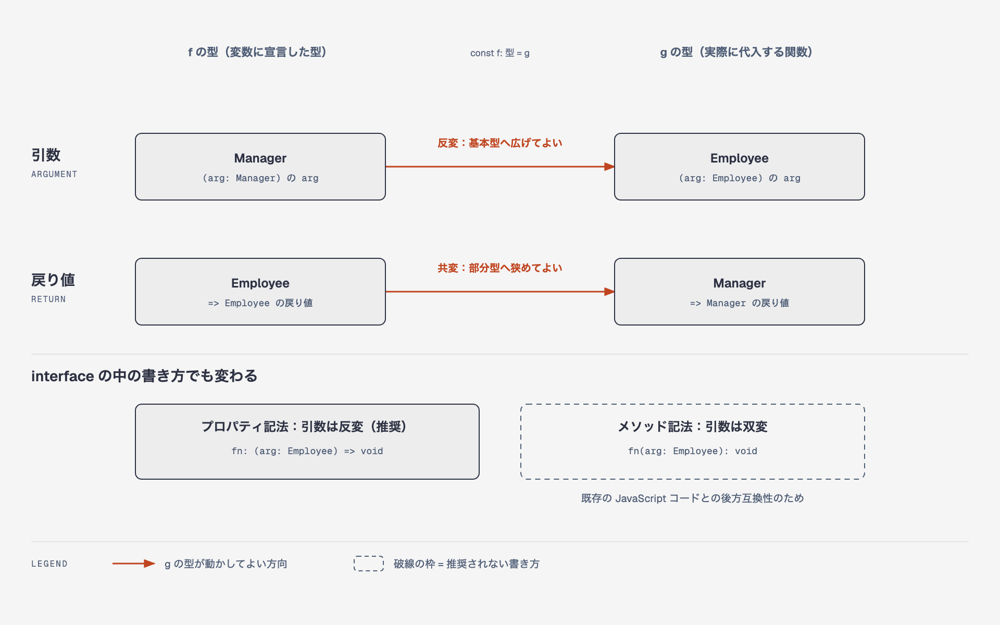

TypeScriptが提供している型機能

- 型推論　明示的に指定しなくても、初期値や戻り値から推論してくれる
- 型注釈　明示的に型を開発者が指定をする
- 型定義　interfaceやtypeによって型を定義する方法
- 型の絞り込み　条件分岐などを用いて型をより具体的に定義する
- 型操作　inferなどを利用して操作する
- 型アサーション　ルールを覆して型を指定する

as constの役割としては、内部のプロパティを不変に保ちたい場合に利用する。

型注釈は、型推論ができなくanyになってしまうような場合・オブジェクトの型を指定したい場合に利用する。

交差型と合併型については、型定義では直感的であれば、オブジェクトで行う場合には、注意が必要になる。

&nbsp;

型操作

- ジェネリクス　
- keyof型演算子　型定義のキー名を取得する
- typeof型演算子　値の型定義を取得する。
- インデックスアクセス型　オブジェクトの型を取得する方法
- 条件付き型　
- マップ型
- テンプレートリテラル型

ジェネリクス

- 型定義の際に、一部は決まっているが、変更したい型の部分もある。こうしたケースに対応する。
- extendsで、変更したい型の内容をある程度絞ることもできる

マップ型

- 既存の型をもとに新しい型を生成する時に有用になる
  - keyof T によって、Key名前を取得
  - インデックスアクセスで、オブジェクトの型を取得

ユーティリティ型

- Pick, Omitについては、実際のプロジェクトでも実践例があったので、かなり良い印象がある。

TypeScriptは構造的型つけ言語で、別名でも同じ構造であれば代入できる。

名前的型付けでは、命名が異なれば構造が一緒でも別のものとして扱うことになる。それをTSで実現するのが、ブランド型になる。

any型は、代入した値に対してアクセスする制限がない。unknownは、型を絞り込んだ場合のみプロパティやメソッドにアクセスできる。

変性

