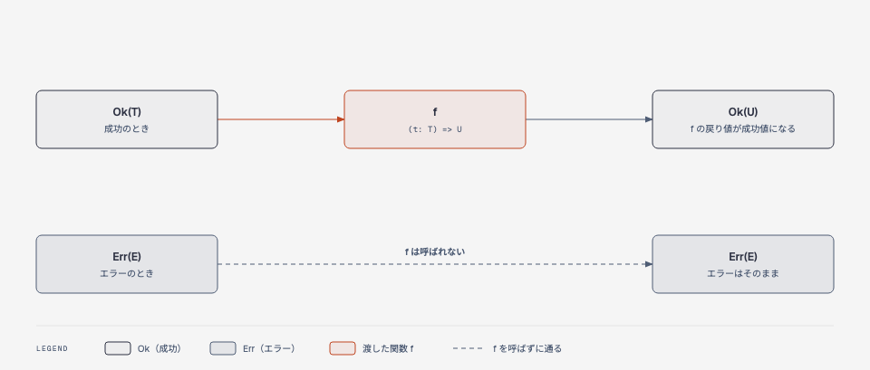
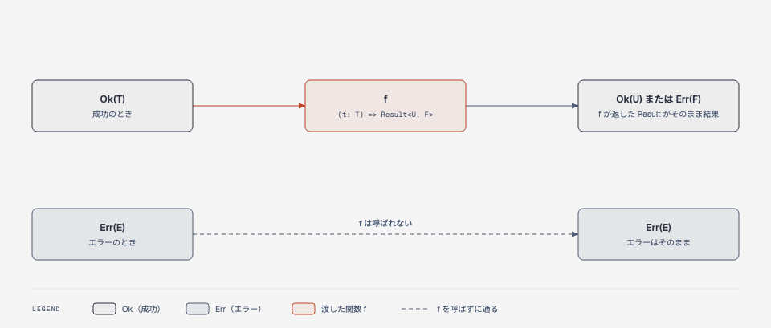
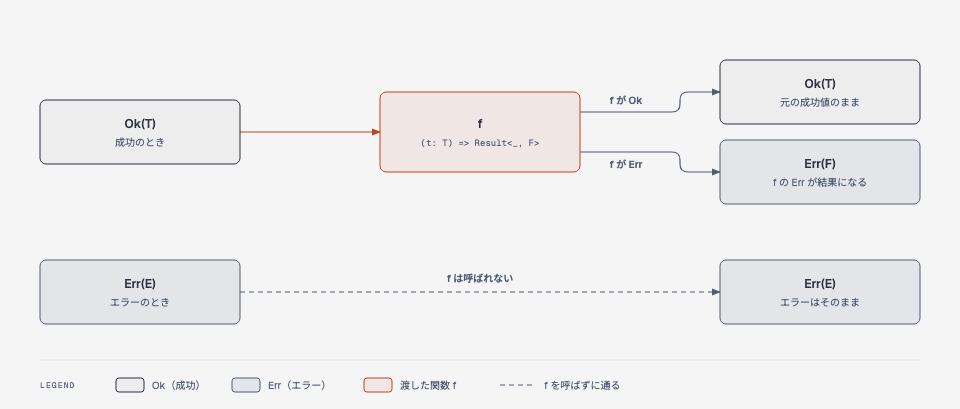
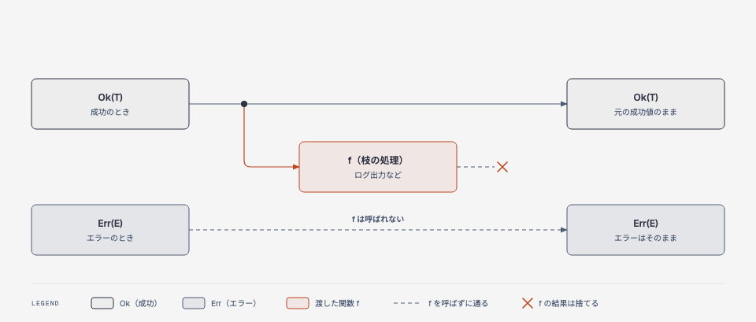
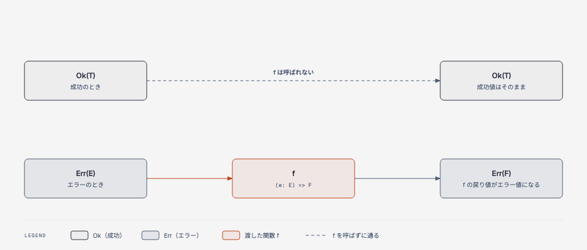
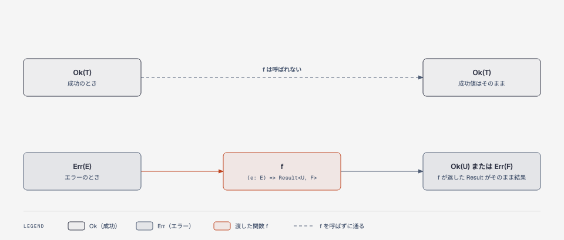
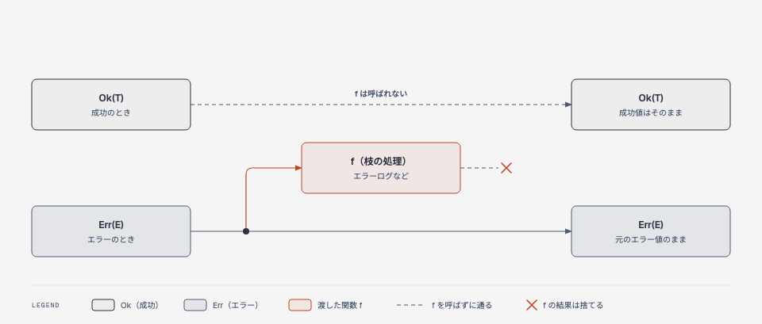

戻り値によるエラーハンドリングの実践

読了範囲: 4.1 〜 4.4（第4章すべて）
対応コード:
- `code/result-map-demo.ts`（4.2.1 `map`）
- `code/result-through-demo.ts`（4.2.5 `andThrough` / `andTee`）
- `code/result-combine-demo.ts`（4.4.1 `Result.combine`。配列とタプル）
- `code/something-error.ts`（書籍のコード片に出てくる `SomethingError`。上のコードから使う）
- 確認コードが無い範囲: 4.1、4.2.2〜4.2.4、4.2.6、4.3、4.4.2、`ResultAsync` を使う例（4.2.2〜4.2.4、4.2.6 は図あり）

## この章で理解すること

- NeverThrow の `Result` / `ResultAsync` で、成功とエラーを値として扱いながら関数を組み合わせる方法

## 手書き `Result` と NeverThrow の違い

（第3章の手書き `Result` を置き換えたあとに整理する）

便利で安全なAPIが提供されており、それを利用することによって、さまざまなケースに対応する方法が簡単に記載することができる

## 4.1 `Result` / `ResultAsync` へのラップ

- 成功値・エラー値の作り方
  - ok, err関数によって作成
  - 提供されているisOkやisErrなどの関数を使って、型ガードの実装をする
- 例外や Promise の拒否を `Result` / `ResultAsync` に変換する方法
  - Resultの型定義や、Result.fromThrowableとで関数を囲って、処理を記載する
    - 第一引数が実行する関数
    - 第二引数が、エラー時に処理をする関数

## 4.2 関数適用

- `map` / `mapErr` / `andThen` / `orElse` / 差し込み処理
  - map: 
    - Result型の変数の値が、okの場合は、渡された関数を、okのvalueの内容をもとに処理する。
    - errorの場合は何も実行しない
    - 関数適用した後は、関数の戻り値の型を成功値とするResult型になる。
    - 元のResultは変更されず、新しいResultが返る
  - mapErr: mapの逆。`Err` の値だけを変換し、`Ok` はそのまま通す
  - `Result` は `Ok` か `Err` のどちらか一方なので、片方だけを変換するメソッドが、別々に用意されている
    - 「保持したまま」は、変換しない側の値に触れず、そのまま次へ渡すという意味
    - `Err` の間は、`map` や `andThen` に渡した関数は1つも呼ばれない。続いているのは、エラー値が最後まで運ばれること
  - andThen: 渡す関数の戻り値が `Result` のときに使う。mapだと `Result<Result<…>>` と二重になる。andThenはネストを平坦化できる
    - 連結するたびにエラー型がユニオンで加わる（`E | F`）
  - andThrough（4.2.5 差し込み処理）: 成功値を変えずに、`Result` を返す処理（検証など）を差し込む
    - `Ok` のとき、成功値を関数に渡す。関数が `Ok` を返したら元の成功値を維持し、`Err` を返したらそのエラーが結果になる
    - `Err` のときは関数を呼ばず、元のエラーを引き継ぐ
    - 戻り値の型は `Result<T, E | F>`。成功値の型 `T` は変わらず、関数のエラー型 `F` が加わる
    - エラーは付与・合体されない。結果になるのは、元のエラー `E` か、関数が返したエラー `F` のどちらか
    - andThenとの違い: andThenは関数が返した成功値に変わる。andThroughは関数の成功値を捨てて、元の成功値を維持する
  - andTee（4.2.5 差し込み処理）: 成功値を変えずに、ログ出力などの副作用を差し込む
    - `Ok` のとき、成功値を関数に渡す。関数の戻り値や、送出された例外は結果に反映せず、元の `Result<T, E>` を返す
    - `Err` のときは関数を呼ばず、元のエラーを引き継ぐ
    - 非同期（`ResultAsync`）の `andTee` は、例外や Promise の拒否が握りつぶされ、後続に伝播しない。失敗を結果に反映したいときは `andThrough` を使う
  - エラー側の差し込みは `orTee`（4.2.6）。`andTee` と対
- 関数が `Err` を返すときと、例外を投げるときの違い（同期の `Result`。使い捨てのコードで実行して確認）
  - `Err` は、戻り値で返す回復可能な業務上の失敗（第3章の Error）。例外は `Result` の外で起きる想定外の失敗（第3章の Defect / Fault）で、`Result` に包まず、例外のまま上へ伝播して処理を止める（書籍 4.2.5、p.101）

| 渡したメソッド | 関数が `Err` を返したとき | 関数が例外を投げたとき |
| --- | --- | --- |
| `map` / `mapErr` | （`Err` は返せない。普通の値を返す関数） | 例外が伝播する |
| `andThen` / `orElse` | 返した `Result` がそのまま結果になる | 例外が伝播する |
| `andThrough` | その `Err` が結果になる | 例外が伝播する（`Err` に変換されない） |
| `andTee` / `orTee` | 無視される。結果は元のまま | 握りつぶされる。結果は元のまま |

  - `andTee` / `orTee` だけが例外を握りつぶすのは、副作用（ログなど）の失敗を、本流の処理に影響させないため（書籍 4.2.5、p.101）
  - 例外を投げ得る関数を `map` などに渡すなら、境界で `Result.fromThrowable` を使って `Result` に変換する（4.1.2）
  - `ResultAsync` の `andTee` の挙動は、書籍の記述のみで、コードでは未確認
- 関数を連結する理由
  - ifで書くと、1段ごとに成功かを確認するので、入れ子が深くなり、エラー側の扱いも各段に書くことになる
  - map / andThenなら、成功時の処理を上から下へ並べて書ける。途中で `Err` になると、残りの関数は呼ばれず、そのエラーが最後まで運ばれる。分岐は `Result` が引き受ける
  - 結果は `Ok` か `Err` で返るので、呼び出し側は最後に1回だけ確認すればよい（確認の仕方は4.3）
  - 渡す関数は `Result` を知らない独立した関数のままでよい。つなぎ目を `map` / `andThen` が担う
  - （自分の解釈。書籍に同じ文言はない）
- 関数を `Result` を返すものと返さないものに分ける基準（第3章の「呼び出し元で分岐をさせるか」と同じ考え方）
  - 失敗しない関数 → `Result` を使わない普通の関数 → チェーンでは `map` で渡す
  - 回復可能な失敗があり、呼び出し側が分岐したい関数 → `Result` を返す関数 → チェーンでは `andThen` で渡す
  - 回復不可能なもの → 例外で止める（第3章）
  - 2種類の関数を同じチェーンで混ぜて使えるように、NeverThrow が `map` / `andThen` を用意している
  - 「`Result` を返さない」と「純粋関数」は別の軸。`Result` を返す関数も、副作用がなければ純粋関数
  - （自分の解釈。使い分けの基準を書籍が4.2で明示しているわけではない）
- 書籍の例（`f1`〜`f3`、4.2.3）の読み方
  - `f1`（2倍）と `f2`（文字列化）は、実際には失敗しない。型を `andThen` に渡せる形にしてあるだけ
  - `f3` は、文字列が `'NaN'` なら `err`。文字列化の失敗ではなく、元の数値が `NaN` だったことの検査
  - 要点は、連結するたびに成功値の型が変わり（`number` → `string`）、エラー型が増えていくこと（`SomethingError | undefined`）
- 関数に渡されるのは `Result` 自体ではなく、中身（成功値かエラー値）。`map` / `andThen` / `andThrough` / `andTee` は成功値、`mapErr` / `orElse` / `orTee` はエラー値を受け取る。関数は `Result` を知らなくてよい

### メソッド名の整理（自分の整理。書籍が明記しているわけではない）

- `and` が付くものは `Ok` のとき、`or` が付くものは `Err` のときに関数を適用する
  - 書籍が「対になる」と書いているのは、`andThen` と `orElse`（4.2.4）、`andTee` と `orTee`（4.2.6）
  - `andThrough` に対応するエラー側のメソッドは、4.2 の範囲には無い

|                  | `Ok` のとき（`and`） | `Err` のとき（`or`） |
| ---------------- | --------------- | --------------- |
| 関数が普通の値を返す       | `map`           | `mapErr`        |
| 関数が `Result` を返す | `andThen`       | `orElse`        |
| 差し込み（副作用）        | `andTee`        | `orTee`         |

- 成功のとき（`and`）の3つは、2つの問いで選ぶ
  1. 関数の結果で、成功値は変わるか？ 変わる → `andThen`
  2. 変わらないなら、関数の失敗を結果に反映するか？ 反映する → `andThrough`、しない → `andTee`
- 勘違いしたこと
  - `andThrough` は、関数が `Err` を返しても無視するものだと思っていた → 無視するのは `andTee`。`andThrough` は、関数が返した `Err` が結果になる。完全にスルーするのは、元が `Err` のとき（関数が呼ばれない）だけ
  - `andThen` や `andThrough` が適用されるのは `Ok` のときだけ

### 図で思い出す（自分で作った図。書籍の図 4.1〜4.6 とは別）

どの図も、上が `Ok` のとき、下が `Err` のときの流れ。オレンジの枠が、渡した関数 `f`。破線は「`f` を呼ばずにそのまま通る」。

`map`: 成功値を変換する（関数は普通の値を返す）

`andThen`: 成功値に、`Result` を返す関数を連結する

`andThrough`: 成功値は変えずに、検証の失敗だけ結果に反映する

`andTee`: 成功値は変えずに、枝で副作用を流す。T字に分かれて、本流は変わらない

`mapErr`: エラー値を変換する（関数は普通の値を返す）

`orElse`: エラー値に、`Result` を返す関数を連結する（代わりの `Result` に切り替える）

`orTee`: エラー値は変えずに、枝で副作用を流す

### コードで確認したこと

- `code/result-map-demo.ts`: `map` が `Ok` のときだけ関数を適用し、`Err` では呼ばれない。元の `Result` は変わらない
- `code/result-through-demo.ts`: `andThrough` と `andTee`
  - `Ok` で検証が成功 → 元の成功値のまま
  - `Err` → 検証関数は呼ばれない（`andTee` のログも出ない）
  - `Ok` で名前が空 → `andThrough` はその `Err` が結果になる。`andTee` は元の `Ok` のまま
  - `andTee` の関数が例外を投げても `Err` を返しても、結果は元のまま

## 4.3 `Result` のアンラップ

- `match` / `unwrapOr` など
  - match  成功時と失敗時に適用する関数を渡して、それによって処理をしてもらう
  - unwrapOr 失敗時に、特定のデフォルト値を設定する方法を行う。成功時は、そのままの値を取り出す

## 4.4 `Result` リストの統合

- 短絡評価　combine
  - リスト内の最初のErrを返却する
  - 最初にErrを見つけた時点で、後続の要素については検査しない。かつErrの内容のみが返却される
- すべてのエラーの収集　combineWithAllErrors
  - リスト内の全てのErrをまとめて、配列にして返却する

## 各メソッドの使い分け

| やりたいこと                                  | 使うメソッド       | メモ                                                                                                    |
| --------------------------------------- | ------------ | ----------------------------------------------------------------------------------------------------- |
| 成功値を変換する（関数は失敗しない）                      | `map`        | 関数の戻り値は `Result` ではない値                                                                                |
| 成功値を変換する（関数が失敗し得る）                      | `andThen`    | 関数の戻り値が `Result`。エラー型は `E | F` になる                                                                    |
| 成功値は変えずに、検証し、失敗をエラーとして結果に反映する           | `andThrough` | 関数の戻り値が `Result`。`Ok` なら元の成功値を維持。エラー型は `E | F` になる                                                    |
| 成功値は変えずに、ログなどの副作用を差し込む（失敗は結果に反映しない）     | `andTee`     | 関数の戻り値や例外は無視される。結果は元のまま                                                                               |
| エラー値を変換する                               | `mapErr`     | `Ok` はそのまま通す                                                                                          |
| エラーのときに別の処理へフォールバックする（関数が `Result` を返す） | `orElse`     | `andThen` と対。`Err` のときだけ関数を適用し、`Ok` はそのまま通す。戻り値は `Result<T | U, F>`（成功値の型に `U` が加わり、エラー型は `F` に置き換わる） |

## 疑問・あとで戻ること

- `declare` とは何か（TypeScript の補足。書籍のコード片に出てくる）
  - 「この名前の変数や関数があり、型はこうだ」とコンパイラに伝えるだけの宣言。実体（値や処理）は作らない
  - 型チェックでは使えるが、実行すると変数は存在しないので `ReferenceError` になる
  - 書籍のコード片で多用されるのは、実装を書かずに型の動きだけを見せたいから。動かしたいときは `ok(...)` や関数の実装に置き換える
- `ResultAsync` の `andTee` の挙動（例外・Promise の拒否が握りつぶされる）は、非同期のコードでまだ試していない
- 